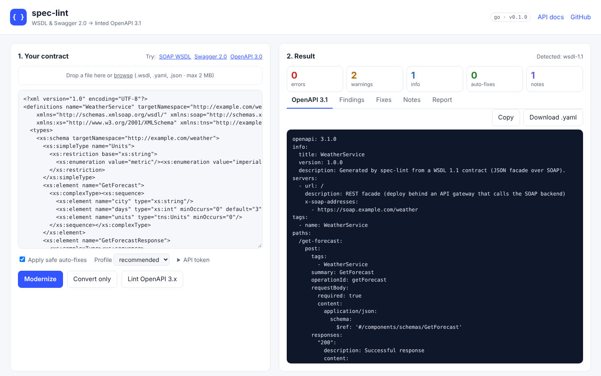
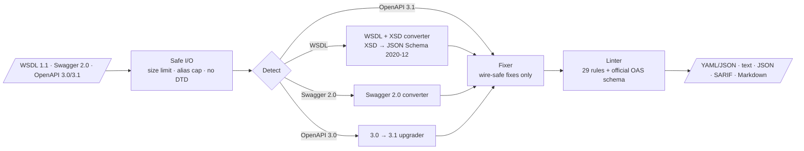

# spec-lint

**Modernize legacy API contracts.** Give it a **WSDL 1.1** SOAP service or a **Swagger 2.0** spec. You get back a standardized, lint-clean **OpenAPI 3.1** document and a migration report.

[](https://github.com/suryayelaswarapu/spec-lint/actions/workflows/ci.yml)
[](https://github.com/suryayelaswarapu/spec-lint/actions/workflows/codeql.yml)


You can run spec-lint as a **command-line tool** or as a **web service** (a REST API with a browser UI). The same tool is built three times:

- **Python**, with FastAPI
- **Java**, with Spring Boot
- **Go**, with net/http

One Gradle build covers all three. A shared conformance suite checks that they all produce byte-identical results.



```text
$ speclint modernize legacy-forecast-rpc.wsdl -o forecast.openapi.yaml --report report.md
note: rpc/encoded binding detected (not WS-I compliant); mapped as literal
note: WSDL has no API version; info.version set to 1.0.0
forecast.openapi.yaml:1  warning  security-defined            No components.securitySchemes defined
forecast.openapi.yaml:2  warning  info-contact                info.contact is missing
forecast.openapi.yaml:2  info     info-license                info.license is missing

3 problems (0 errors, 2 warnings, 1 info)
```

## Contents

1. [Why spec-lint](#why-spec-lint)
2. [Features](#features)
3. [Quick start (5 minutes)](#quick-start-5-minutes)
4. [Run the web service](#run-the-web-service)
5. [REST API reference](#rest-api-reference)
6. [Command-line usage](#command-line-usage)
7. [Configuration (`.speclint.yaml`)](#configuration-speclintyaml)
8. [Worked example: weather services](#worked-example-weather-services)
9. [IDE setup (VS Code and IntelliJ)](#ide-setup)
10. [Build, test and coverage](#build-test-and-coverage)
11. [Architecture and project layout](#architecture-and-project-layout)
12. [Security design](#security-design)
13. [Troubleshooting](#troubleshooting)
14. [Contributing, roadmap and license](#contributing)

---

## Why spec-lint

Many companies still run SOAP services and old Swagger 2.0 specs. Modern API gateways, SDK generators and developer portals need **OpenAPI 3.x** contracts that follow the organization's standards.

Today's tools each solve only part of the problem:

| Need | Typical tool | Gap |
|---|---|---|
| Swagger 2.0 → OpenAPI 3.x | swagger2openapi | Converts to 3.0, not 3.1; does not check standards |
| WSDL → OpenAPI | Gateway import wizards, paid services | Hard to automate, often lossy, often unmaintained |
| Linting | Spectral, Redocly | Lint only, so the legacy contract has to be converted first |

**spec-lint runs the whole pipeline in one command:** *detect → convert → safe auto-fix → lint → report*. It runs in CI, and its SARIF output puts findings in GitHub code scanning.

## Features

- **WSDL 1.1 → OpenAPI 3.1.** Handles:
  - document/literal and rpc styles, including rpc/encoded
  - SOAP 1.1 and 1.2
  - `complexType`, `simpleType`, extension, choice, groups, attributes, enumerations and facets
  - `soapenc:Array` and faults

  See the [WSDL mapping](docs/wsdl-mapping.md) for details.
- **Swagger 2.0 → OpenAPI 3.1.** Covers servers, body and formData parameters, `collectionFormat`, security definitions (every OAuth2 flow), examples, `x-nullable` and boolean exclusive bounds.
- **OpenAPI 3.0 → 3.1.** Converts `nullable`, turns `example` into `examples`, and rewrites exclusive bounds as numbers.
- **29 lint rules** from a shared catalog ([docs/rules.md](docs/rules.md)). They cover naming, structure, error handling (RFC 9457), security, `$ref` hygiene and validation against the official OpenAPI schema.
- **Safe auto-fixes that never break the wire contract.** spec-lint can fix operationIds, tags and schema names, extract inline schemas, and add Problem Details error bodies. It never renames paths or properties.
- **Reports** in four formats: text, JSON, **SARIF 2.1.0** for GitHub code scanning, and a Markdown migration report.
- **Configurable.** `.speclint.yaml` sets the ruleset (`recommended` or `strict`), per-rule severities and `fail-on`. Exit codes are CI-friendly.
- **Secure by default.** See [Security design](#security-design).

---

## Quick start (5 minutes)

### 1. Install the prerequisites

| Tool | Version | Needed for | Check it |
|---|---|---|---|
| **JDK** | **21** (exactly 21 for the build, see note) | Gradle and the Java implementation | `java -version` |
| **Python** | 3.10 or newer | Python implementation | `python3 --version` |
| **Go** | 1.22 or newer | Go implementation | `go version` |
| Git | any | cloning | `git --version` |
| Docker | optional | `docker compose` | `docker --version` |

You don't need to install Gradle. The `./gradlew` wrapper downloads Gradle 8.14.3 on first use.

> **Java version note:** the build needs **JDK 21**. Gradle 8.14 can't run on newer JDKs; on Java 26 it fails with *"Unsupported class file major version 70"*. You can keep newer JDKs installed, but point `JAVA_HOME` at 21 when you build.
>
> ```bash
> # macOS (Homebrew)
> brew install openjdk@21
> export JAVA_HOME=$(/usr/libexec/java_home -v 21)   # add to ~/.zshrc to make it permanent
>
> # Linux (Debian/Ubuntu)
> sudo apt install openjdk-21-jdk
> export JAVA_HOME=/usr/lib/jvm/java-21-openjdk-amd64
>
> # Windows (PowerShell)
> winget install EclipseAdoptium.Temurin.21.JDK
> ```
>
> The repository also pins the Gradle daemon to Java 21 in [`gradle/gradle-daemon-jvm.properties`](gradle/gradle-daemon-jvm.properties). Gradle uses an installed JDK 21 even when your IDE defaults to something newer.

If you only want one language, you only need that language's toolchain plus JDK 21 for Gradle. You can also skip Gradle entirely; see [Command-line usage](#command-line-usage).

### 2. Clone and build

```bash
git clone https://github.com/suryayelaswarapu/spec-lint.git
cd spec-lint            # run every ./gradlew command from this folder
./gradlew check         # builds and tests all three implementations (first run: a few minutes)
```

The first run downloads Gradle, the Maven dependencies and the Go modules. It also creates a Python virtualenv in `python/.venv`.

### 3. Start a server and try it

```bash
./gradlew :java:bootRun        # or :python:serve, or :go:serve
```

1. Open **http://localhost:8080**.
2. Click **SOAP WSDL** to load a sample, or upload your own file.
3. Click **Modernize**.

You'll see the OpenAPI 3.1 result, the fixes that were applied, the findings and the migration report. Interactive API docs (Swagger UI) are at **http://localhost:8080/docs.html**. Stop the server with `Ctrl+C`.

### 4. Try the CLI

```bash
./gradlew :go:goBuild
go/build/speclint modernize testdata/weather/weather-service.wsdl -o /tmp/weather.yaml --report /tmp/report.md
cat /tmp/report.md
```

---

## Run the web service

All three implementations serve the **same REST API** ([contract](docs/api/openapi.yaml)) and the **same web UI** on **http://localhost:8080**.

| Implementation | Entry point ("Application" file) | Start with Gradle | Start without Gradle |
|---|---|---|---|
| **Java / Spring Boot** | [`SpecLintApplication.java`](java/src/main/java/io/github/suryayelaswarapu/speclint/SpecLintApplication.java) | `./gradlew :java:bootRun` | `./gradlew :java:bootJar && java -jar java/build/libs/speclint.jar` |
| **Python / FastAPI** | [`server/app.py`](python/src/speclint/server/app.py) | `./gradlew :python:serve` | `pip install -e "python[server]" && speclint serve` |
| **Go / net/http** | [`internal/server/server.go`](go/internal/server/server.go) | `./gradlew :go:serve` | `cd go && go run ./cmd/speclint serve` |
| **All three at once** | [`docker-compose.yml`](docker-compose.yml) | n/a | `docker compose up --build` (Java on :8081, Python on :8082, Go on :8083) |

To use a different port, add `-Pport=9090` to any Gradle `serve`/`bootRun` command, or pass `--port 9090` to `speclint serve`.

### Server settings

The three implementations read the same settings.

| Setting | Default | Meaning |
|---|---|---|
| `--port` / `PORT` (Java) | `8080` | Port to listen on |
| `--host` / `SPECLINT_HOST` (Java) | `127.0.0.1` | Address to bind. The default is local only; containers use `0.0.0.0`. |
| `SPECLINT_MAX_BYTES` | `2097152` (2 MiB) | Request body limit. Larger requests get `413`. It must be a positive whole number of bytes, and the server **refuses to start** on a value like `2MB`. |
| `SPECLINT_API_TOKEN` | *(unset)* | If set, every `POST /api/v1/*` needs `Authorization: Bearer <token>`. `GET` endpoints stay open. |

```bash
SPECLINT_API_TOKEN=change-me SPECLINT_MAX_BYTES=5242880 ./gradlew :go:serve
```

> Keep tokens out of the repository. Set them in your shell or in a secret manager; `.env*` files are git-ignored.

---

## REST API reference

The base URL is `http://localhost:8080`. Requests and responses are JSON. Errors use `application/problem+json` (RFC 9457). The complete contract is [`docs/api/openapi.yaml`](docs/api/openapi.yaml); every server also serves it at `/api/v1/openapi.yaml`.

| Method and path | Purpose | Request body | Response fields |
|---|---|---|---|
| `POST /api/v1/modernize` | Convert, fix and lint. **Start here.** | `spec`, `filename`?, `config`?, `fix`? (default `true`) | `sourceKind`, `openapi`, `yaml`, `warnings`, `fixes`, `summary`, `findings`, `report` |
| `POST /api/v1/convert` | Convert only | `spec`, `filename`? | `sourceKind`, `openapi`, `yaml`, `warnings` |
| `POST /api/v1/lint` | Lint an OpenAPI 3.x document | `spec`, `filename`?, `config`? | `summary`, `findings` |
| `POST /api/v1/fix` | Apply the safe auto-fixes | `spec`, `filename`? | `openapi`, `yaml`, `fixes` |
| `GET /api/v1/rules` | Rule catalog | none | `rules[]` with `id`, `severity`, `fixable`, `description` |
| `GET /health` | Liveness check | none | `status`, `version`, `implementation` |

Request fields:

- `spec` is the contract's **text** (WSDL XML, or YAML/JSON).
- `filename` is optional. It's used in reports and when guessing the format.
- `config` takes the same shape as [`.speclint.yaml`](#configuration-speclintyaml), for example `{"extends": "strict", "rules": {"info-license": "off"}}`.

### Example: modernize a WSDL

```bash
curl -s localhost:8080/api/v1/modernize \
  -H 'Content-Type: application/json' \
  -d "$(jq -Rs '{spec: ., filename: "weather.wsdl"}' testdata/weather/weather-service.wsdl)" \
  | jq '{sourceKind, warnings, summary, firstFinding: .findings[0]}'
```

```json
{
  "sourceKind": "wsdl-1.1",
  "warnings": ["WSDL has no API version; info.version set to 1.0.0"],
  "summary": { "error": 0, "warning": 2, "info": 1 },
  "firstFinding": {
    "rule": "security-defined",
    "severity": "warning",
    "message": "No components.securitySchemes defined",
    "path": "",
    "line": 1
  }
}
```

In this response:

- `openapi` holds the converted document as JSON, and `yaml` holds the same document as text, ready to save.
- `report` is the Markdown migration report.
- Each finding's `path` is a JSON Pointer into the document (`""` means the root), and `line` is the line in `yaml`.

### Example: lint a document

```bash
curl -s localhost:8080/api/v1/lint -H 'Content-Type: application/json' \
  -d '{"spec": "openapi: 3.1.0\ninfo: {title: Demo, version: 1.0.0}\npaths: {}\n"}'
```

```json
{
  "summary": { "error": 1, "warning": 3, "info": 1 },
  "findings": [
    { "rule": "servers-defined", "severity": "error", "message": "No servers defined", "path": "", "line": 1 },
    { "rule": "info-contact", "severity": "warning", "message": "info.contact is missing", "path": "/info", "line": 2 }
  ]
}
```

(The response is shortened.)

### Errors

Every error has the same shape in all three implementations:

```json
{ "type": "about:blank", "title": "Invalid input", "status": 400, "detail": "Input is WSDL; use /api/v1/modernize or /api/v1/convert" }
```

| Status | When |
|---|---|
| `400` | The body isn't a JSON object with a non-empty `spec`, the spec can't be parsed, or the input is the wrong kind for the endpoint |
| `401` | `SPECLINT_API_TOKEN` is set and the bearer token is missing or wrong (the response includes `WWW-Authenticate: Bearer`) |
| `413` | The body is larger than `SPECLINT_MAX_BYTES` |
| `422` | The input was rejected as unsafe (DOCTYPE/XXE, YAML alias bomb and similar) |
| `500` | Unexpected error. The body never includes a stack trace or your contract. |

### Authenticated request

```bash
curl -s localhost:8080/api/v1/lint -H "Authorization: Bearer $SPECLINT_API_TOKEN" \
  -H 'Content-Type: application/json' -d '{"spec": "openapi: 3.1.0\ninfo: {title: x, version: 1}\npaths: {}"}'
```

---

## Command-line usage

All three implementations have the **same CLI** with the same output. Pick one:

```bash
# Python 3.10+ (from the spec-lint folder)
python3 -m venv .venv && source .venv/bin/activate
pip install -e python                 # add "[server]" for `speclint serve`
speclint --help

# Go 1.22+
cd go && go build -o speclint ./cmd/speclint && ./speclint --help

# Java 21 (the CLI entry point is Main.java)
./gradlew :java:installDist && java/build/install/speclint/bin/speclint --help

# Docker (Go image, distroless, runs as non-root)
docker build -f go/Dockerfile -t speclint-go .
docker run --rm -v "$PWD:/work" speclint-go lint /work/api.yaml
```

### Commands

| Command | What it does |
|---|---|
| `speclint modernize INPUT [-o OUT] [--report R.md] [--sarif R.sarif] [--no-fix] [-c CONFIG] [--fail-on LEVEL]` | Convert, fix and lint. The main command for legacy specs. |
| `speclint convert INPUT [-o OUT] [-f yaml\|json]` | Convert only (Swagger 2.0, OpenAPI 3.0 or WSDL 1.1 → OpenAPI 3.1) |
| `speclint lint INPUT [--format text\|json\|sarif] [-o REPORT] [-c CONFIG] [--fail-on LEVEL]` | Lint an OpenAPI 3.x document |
| `speclint fix INPUT [-o OUT] [-c CONFIG]` | Apply the safe auto-fixes |
| `speclint rules [--format json]` | List all rules |
| `speclint serve [--host H] [--port P]` | Start the web service |

Notes:

- The output format follows the `-o` file extension (`.json` or `.yaml`). With no `-o`, output goes to stdout.
- `--no-local-imports` stops the WSDL converter from reading `xsd:import` files next to the input.
- The global option `--max-size BYTES` sets the input size limit (default 10 MiB).

**Exit codes** (for CI):

- `0`: success
- `1`: findings at or above `--fail-on` (default `error`)
- `2`: usage or input error

### Common recipes

```bash
speclint modernize legacy.wsdl -o openapi.yaml --report MIGRATION.md      # SOAP → OpenAPI + report
speclint modernize swagger.json -o openapi.json --no-fix                   # convert and lint, no fixes
speclint lint openapi.yaml --format sarif -o speclint.sarif --fail-on warning
speclint rules --format json | jq '.[] | select(.fixable)'                 # rules that auto-fix
```

### Use it in CI (GitHub Actions)

```yaml
- run: speclint modernize api/legacy.wsdl -o api/openapi.yaml --sarif speclint.sarif --fail-on error
- uses: github/codeql-action/upload-sarif@v3
  if: always()
  with: { sarif_file: speclint.sarif }
```

---

## Configuration (`.speclint.yaml`)

The CLI reads `.speclint.yaml` (or `.speclint.yml`) from the current folder. You can also point it at a file with `-c path`. The API takes the same shape in the request's `config` field.

```yaml
extends: recommended      # recommended (default) | strict (warnings become errors, info becomes warning)
fail-on: error            # error | warning | info | never  (CLI exit code 1 at or above this level)
rules:                    # per-rule overrides: error | warning | info | off
  info-license: off
  property-camel-case: error
  security-defined: info
```

Unknown rule IDs and invalid severities are rejected with a clear message. Run `speclint rules` to see every ID, or read [docs/rules.md](docs/rules.md) for what each rule checks and why.

---

## Worked example: weather services

[`testdata/weather`](testdata/weather) contains three realistic legacy contracts. [`examples/weather`](examples/weather) holds the **committed outputs and migration reports**, so you can see the results without running anything.

| Input | What it exercises | Result |
|---|---|---|
| [`weather-service.wsdl`](testdata/weather/weather-service.wsdl) | Clean document/literal SOAP with SOAP 1.1 and 1.2 ports, enums, numeric ranges, `xs:choice`, extension, nillable and faults | [OpenAPI](examples/weather/weather-service.openapi.yaml) · [report](examples/weather/weather-service.report.md) |
| [`legacy-forecast-rpc.wsdl`](testdata/weather/legacy-forecast-rpc.wsdl) | An rpc/encoded service in the style of older government forecast APIs (for example NOAA's NDFD), with RPC parts and `soapenc:Array` | [OpenAPI](examples/weather/legacy-forecast-rpc.openapi.yaml) · [report](examples/weather/legacy-forecast-rpc.report.md) |
| [`weather-api-v2.yaml`](testdata/weather/weather-api-v2.yaml) | Swagger 2.0 with typical problems: missing operationIds, snake_case, inline schemas, a trailing slash and `x-nullable` | [OpenAPI](examples/weather/weather-api-v2.openapi.yaml) · [report](examples/weather/weather-api-v2.report.md) |

The Swagger example shows the fixer at work. It applies **13 safe fixes**, for example:

- adding the missing operationIds
- renaming `GetForecast` to `getForecast`
- extracting inline schemas
- adding RFC 9457 error responses

It leaves **18 findings** that need a human decision. One example is renaming `temperature_c`, which would break existing clients.

How a WSDL maps to OpenAPI, in short:

- Each SOAP operation becomes `POST /operation-name` with JSON request and response bodies.
- Faults become a `500` `SoapFault` response.
- The SOAP routing details (`soapAction`, binding, port) are kept under `x-soap`, so a gateway can call the backend.

> Want to try a real government WSDL? Download NOAA's NDFD WSDL (`https://digital.weather.gov/DWML-TSML/xml/wsdl/ndfdXML.wsdl`) and run `speclint modernize ndfdXML.wsdl`. The tests never call live services; every fixture is committed.

---

## IDE setup

### VS Code

1. **Open the `spec-lint` folder itself** (File → Open Folder…), not its parent folder. VS Code only detects the Gradle build when `settings.gradle.kts` is at the workspace root.
2. Install these extensions:
   - **Extension Pack for Java** (Microsoft), which includes Gradle support
   - **Spring Boot Extension Pack** (VMware), optional, adds a Spring Boot dashboard
   - **Python** (Microsoft)
   - **Go** (Go Team at Google)
3. Point the Java extension at JDK 21 with *Preferences: Open Workspace Settings (JSON)*. Adjust the path for your machine (`/usr/libexec/java_home -v 21` prints it on macOS):

   ```json
   {
     "java.import.gradle.java.home": "/Library/Java/JavaVirtualMachines/temurin-21.jdk/Contents/Home",
     "java.configuration.runtimes": [
       { "name": "JavaSE-21", "path": "/Library/Java/JavaVirtualMachines/temurin-21.jdk/Contents/Home", "default": true }
     ],
     "python.defaultInterpreterPath": "${workspaceFolder}/python/.venv/bin/python"
   }
   ```

4. Run *Java: Clean Java Language Server Workspace* and reload the window. A **Run | Debug** link then appears above `main` in `SpecLintApplication.java` and `Main.java`.
5. For Python, run `./gradlew :python:install` once to create `python/.venv`, then choose that interpreter. Pytest tests appear in the Testing view.
6. For Go, open a file under `go/` and accept the prompt to install the Go tools. Tests show **run test** links.

### IntelliJ IDEA

1. Open the `spec-lint` folder. IntelliJ imports the Gradle build automatically.
2. In *Settings → Build Tools → Gradle*, set the **Gradle JVM** to a JDK 21.
3. Click the green ▶ next to `SpecLintApplication` to start the web service, or next to `Main` to run the CLI. You can add program arguments such as `modernize testdata/weather/weather-service.wsdl` in the run configuration.

---

## Build, test and coverage

Run every command from the `spec-lint` folder.

| Goal | Command |
|---|---|
| Build and test **everything** (lint, type checks, tests, coverage gates ≥ 80%) | `./gradlew check` |
| One language only | `./gradlew :python:check`, `./gradlew :java:check` or `./gradlew :go:check` |
| Cross-language conformance only | `./gradlew conformance` |
| Copy the web UI or API contract into the Python and Go source trees (after editing `/web` or `docs/api/openapi.yaml`) | `./gradlew syncWebAssets` |
| Build the CLIs | `./gradlew :java:installDist :go:goBuild` |

Running each toolchain directly is faster when you are iterating:

```bash
cd python && .venv/bin/pytest -q                 # plus: .venv/bin/ruff check src tests && .venv/bin/mypy
cd java   && ../gradlew test                     # JUnit 5 + AssertJ + Spring MockMvc
cd go     && go test -race ./...                 # plus: go vet ./...
```

| Language | Quality gates | Coverage report |
|---|---|---|
| Python | ruff (lint and format), mypy `--strict`, pytest-cov ≥ 80% | terminal output and `python/build/coverage.xml` |
| Java | `javac -Xlint:all -Werror`, JaCoCo ≥ 80% lines and ≥ 70% branches | `java/build/reports/jacoco/test/html/index.html` |
| Go | `go vet`, `go test -race`, ≥ 80% statements | `go tool cover -html=go/build/coverage.out` |

Coverage at the time of writing: **Python 98%, Java 98% lines and 90% branches, Go 98%.**

### Changing behavior

The Python implementation is the reference. If you change a rule, a fix or a converter:

1. Update Python and its tests.
2. Regenerate the golden files: `cd python && .venv/bin/python scripts/update_golden.py`.
3. Make Java and Go pass `./gradlew conformance`.
4. Update `docs/rules.md` and `CHANGELOG.md`.

See [CONTRIBUTING.md](CONTRIBUTING.md) for details.

---

## Architecture and project layout



| Stage | Python (`python/src/speclint`) | Java (`java/src/main/java/.../speclint`) | Go (`go/internal`) |
|---|---|---|---|
| Safe I/O and detection | `io.py`, `detect.py` | `io/SpecIO`, `SpecKind` | `specio` |
| Converters | `convert/` | `convert/` | `convert` |
| Rules, config and schema validation | `lint/` | `lint/` | `lint` |
| Auto-fixes | `fix.py` | `fix/Fixer` | `fix` |
| Pipeline (`modernize`) | `modernize.py` | `Modernizer` | `pipeline` |
| Reports | `report.py` | `report/Reports` | `report` |
| CLI | `cli.py` (click) | `Main` (picocli) | `app` (standard `flag`) |
| Web service | `server/` (FastAPI) | `server/`, `SpecLintApplication` (Spring Boot) | `server` (`net/http`) |

### Repository layout

```text
spec-lint/
├── build.gradle.kts, settings.gradle.kts, gradlew   ./gradlew check runs everything
├── gradle/                 wrapper + daemon JVM pin (Java 21)
├── python/                 Python 3.10+  (pytest, ruff, mypy --strict); build.gradle.kts wraps a venv
├── java/                   Java 21       (Spring Boot 3, picocli, JUnit 5, AssertJ, JaCoCo)
├── go/                     Go 1.22+      (standard library + yaml.v3 + jsonschema)
├── web/                    browser UI shared by all three servers (no framework, no inline script)
├── docs/                   rules.md, wsdl-mapping.md, api/openapi.yaml (REST contract), images/
├── schemas/openapi/        official OpenAPI 3.0/3.1 JSON Schemas (vendored, Apache-2.0)
├── testdata/
│   ├── weather/            sample legacy contracts (WSDL, Swagger 2.0)
│   ├── openapi/            OpenAPI 3.0 sample
│   ├── security/           hostile inputs: XXE, billion laughs, path traversal, alias bomb…
│   └── conformance/        golden files that all three implementations must match
├── examples/weather/       committed modernize outputs and migration reports
├── .github/                CI (build, matrix, dogfood, docker, gitleaks), CodeQL, Dependabot, templates
├── docker-compose.yml      all three servers side by side on :8081 / :8082 / :8083
└── SECURITY.md, CONTRIBUTING.md, CHANGELOG.md, LICENSE
```

### Design decisions

- **One spec, three implementations, one contract.** Python generates golden files in `testdata/conformance`. Java and Go must reproduce exactly the converted document, the fixed document, the applied fixes and the findings. "Same behavior in three languages" is a test that fails, not just a promise.
- **WSDL becomes a JSON facade, not a 1:1 description of the SOAP protocol.** Each operation becomes `POST /operation-name` with JSON bodies, which is what an API gateway or a strangler-fig migration actually exposes. SOAP routing details stay in `x-soap`.
- **The fixer never renames wire names.** Renaming `temperature_c` to `temperatureC` breaks clients, so spec-lint reports it instead of fixing it. Internal names, such as schema keys and operationIds, are safe to fix.
- **Line numbers point at the file that was written.** `modernize` serializes the output first and maps each finding to a line in that text, so text and SARIF reports point at the real output file.
- **Thin HTTP layer.** Each server hands requests to a framework-free `service` module. Request handling is tested without a network, and the web frameworks stay swappable.
- **Each language uses its own idiomatic libraries.** Every implementation validates against the **official OAI JSON Schemas**, using jsonschema (Python), networknt (Java) and santhosh-tekuri/jsonschema (Go). The validators' error messages differ, so conformance doesn't compare them; the rules behave the same.

---

## Security design

spec-lint parses untrusted input, so it treats every file as hostile.

| Threat | Mitigation | Test |
|---|---|---|
| XXE (file disclosure, SSRF) | Any DOCTYPE is rejected: defusedxml (Python), JAXP secure processing (Java), DOCTYPE check (Go) | `testdata/security/xxe.wsdl` |
| Entity-expansion DoS ("billion laughs") | Same as above | `billion-laughs.wsdl` |
| YAML alias bomb | At most 100 aliases; safe loaders only (no object tags) | `yaml-aliases.yaml` |
| SSRF through remote imports or `$ref` | Nothing is ever fetched. A remote `xsd:import` is reported. A remote `$ref` is a lint error, and schema validation skips the unvetted refs. | `remote-import.wsdl`, `remote-ref.yaml` |
| Path traversal through `schemaLocation` | Local imports must resolve inside the input's folder; at most 50 documents, each size-limited | `path-traversal.wsdl` |
| Oversized input | `--max-size` (default 10 MiB), checked before reading. Every rule is linear-time; a 1.3 MB contract takes seconds. | unit tests |
| Abuse of the web service | See the list below | server tests in all three languages |
| Third-party script tampering | Swagger UI is pinned to an exact version with Subresource Integrity (`sha384`), and the CSP allows only that versioned path | `test_external_assets_are_pinned_with_sri` |
| Leaked secrets in the repo | gitleaks in pre-commit and CI. `.gitignore` excludes `.env`, keys and keystores. Reports include file names only, never absolute paths. | CI `secrets` job |

The web service's own defenses:

- A 2 MiB body limit, also enforced on chunked uploads.
- An optional bearer token, compared in constant time. Unauthenticated requests are rejected **before** the server reads the body.
- No file-system reads (local imports are disabled).
- RFC 9457 errors without stack traces.
- Strict security headers: CSP, `X-Frame-Options: DENY` and `nosniff`.
- The server binds to `127.0.0.1` by default.
- Containers are read-only and run as non-root.

Dependabot keeps the Gradle, pip, Go module and GitHub Actions dependencies up to date, and CodeQL analyzes all three languages. To report a vulnerability, see [SECURITY.md](SECURITY.md).

---

## Troubleshooting

| Symptom | Cause | Fix |
|---|---|---|
| `Unsupported class file major version 70` (or 69, 68…) | Gradle is running on a JDK newer than it supports (70 = Java 26) | Install JDK 21 and `export JAVA_HOME=$(/usr/libexec/java_home -v 21)`. In VS Code, set `java.import.gradle.java.home`; in IntelliJ, set the Gradle JVM. See [Quick start](#1-install-the-prerequisites). |
| `zsh: no such file or directory: ./gradlew` | You're not in the project folder | `cd spec-lint` (the folder that contains `gradlew`) |
| `permission denied: ./gradlew` | The execute bit was lost (for example, after a zip download) | `chmod +x gradlew` |
| No **Run** button in VS Code | You opened the parent folder, or the Java extension is using the wrong JDK | Open the `spec-lint` folder itself, set JDK 21 (see [VS Code](#vs-code)), then run *Java: Clean Java Language Server Workspace* |
| `Address already in use` / `port in use` | Something is already listening on 8080 | Stop it, or use another port: `./gradlew :go:serve -Pport=9090` |
| Server exits with `SPECLINT_MAX_BYTES must be a positive whole number of bytes` | The value has a unit, like `2MB` | Use bytes: `SPECLINT_MAX_BYTES=2097152` |
| `401 Unauthorized` from the API | `SPECLINT_API_TOKEN` is set on the server | Send `Authorization: Bearer <token>`, or paste the token into the web UI's token field |
| `413 Payload too large` | The request is bigger than `SPECLINT_MAX_BYTES` | Raise the limit, or use the CLI (default limit 10 MiB, `--max-size` to change) |
| `:python:install` fails or uses an old Python | `python3` on your PATH is older than 3.10 | `./gradlew :python:check -Ppython=python3.12`, or delete `python/.venv` and retry |
| `go: command not found` during `./gradlew check` | Go isn't installed or not on PATH | Install Go 1.22+, or build a single language with `./gradlew :java:check` |
| Swagger UI page at `/docs.html` is blank | The browser can't reach unpkg.com (offline or corporate proxy) | The API still works. Use [`docs/api/openapi.yaml`](docs/api/openapi.yaml) directly. |
| `WSDL ... remote import not fetched` note | The WSDL imports XSD over HTTP; spec-lint never fetches URLs | Download the XSD next to the WSDL, point `schemaLocation` at the local file and use the CLI (the API never reads local files) |

---

## Contributing

Contributions are welcome. [CONTRIBUTING.md](CONTRIBUTING.md) explains:

- the development workflow
- how to keep the three implementations in sync
- the commit style

Run `pre-commit install` once so that gitleaks, ruff and gofmt run before every commit.

### Roadmap

- [ ] WSDL 2.0, and `wsdl:import` of other WSDL documents
- [ ] SOAP headers → OpenAPI header parameters
- [ ] Opt-in, allow-listed remote `$ref` bundling
- [ ] Custom rules (export as a Spectral-compatible ruleset)
- [ ] Published packages: PyPI `spec-lint`, Maven Central, `go install`, container images and a GitHub Action
- [ ] Rate limiting and OAuth2 for public deployments

### License

[MIT](LICENSE) © 2026 Surya Yelaswarapu. The vendored OpenAPI JSON Schemas are © the OpenAPI Initiative, under Apache-2.0 (see [schemas/openapi/NOTICE.md](schemas/openapi/NOTICE.md)).
